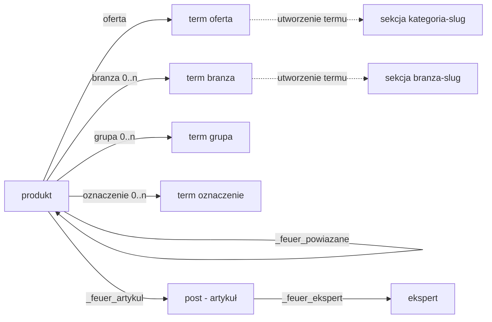

# Model treści

Przegląd modelu treści serwisu: typy wpisów, taksonomie, relacje między obiektami, reguły wspólne. Szczegóły — dokumenty obiektów: [produkt.md](produkt.md), [taksonomie.md](taksonomie.md), [artykuly.md](artykuly.md), [sekcje.md](sekcje.md), [ustawienia.md](ustawienia.md), [media.md](media.md); uprawnienia: [uprawnienia.md](uprawnienia.md).

## Zakres

- **[kr68kr]** Serwis prezentuje ofertę (brand awareness); e-commerce jest poza zakresem — ewentualnie osobny byt w przyszłości (np. subdomena, dowolny silnik).

## Typy wpisów

| ID | Typ | Przeznaczenie | Dokument |
|---|---|---|---|
| **[mtdru5]** | `produkt` | produkty oferty: szkolenia i usługi | [produkt.md](produkt.md) |
| **[6qhzx9]** | `post` | artykuły Bazy wiedzy | [artykuly.md](artykuly.md) |
| **[65akj5]** | `ekspert` | autorzy artykułów | [artykuly.md](artykuly.md) |
| **[kurdhj]** | `sekcja` | redagowalne fragmenty stron systemowych i ramy strony | [sekcje.md](sekcje.md) |
| **[4pubbu]** | `page` | strony | niżej |

- **[38t6vv]** Typy własne (`produkt`, `sekcja`, `ekspert`) i ich pola meta rejestruje kod wtyczki `feuer-komponenty` — źródło danych dla bloków; `post` i `page` to typy natywne.
- **[62j8p2]** `page` — natywny typ stron: hierarchiczny (strona nadrzędna i podstrony), publiczny, w REST (`pages`); obsługuje tytuł, treść, autora, obrazek wyróżniający, atrybuty strony i pola własne.
- **[p8nkhw]** Strona (`page`) ma pola SEO — „Tytuł dla wyszukiwarek" (`_feuer_seo_tytul`) i „Opis dla wyszukiwarek" (`_feuer_seo_opis`): [seo.md](seo.md), „Pola nadpisania".
- **[aaqnca]** Typu `ksiazka` nie ma — poza zakresem do czasu projektu karty lub strony książki.

## Taksonomie

| ID | Taksonomia | Przeznaczenie | Dokument |
|---|---|---|---|
| **[v9y89f]** | `oferta` | kategorie oferty — drzewo, strony kategorii | [taksonomie.md](taksonomie.md) |
| **[ye9p4k]** | `branza` | branże — strony branż | [taksonomie.md](taksonomie.md) |
| **[v43v5z]** | `grupa` | grupy produktów | [taksonomie.md](taksonomie.md) |
| **[tscs5p]** | `oznaczenie` | TOP 20 i miesiące — słownik zamknięty | [taksonomie.md](taksonomie.md) |

## Relacje

- Linia ciągła — pole albo taksonomia obiektu; przerywana — sekcja tworzona automatycznie przy utworzeniu termu ([sekcje.md](sekcje.md)).

## Wspólne

- **[s5367e]** Komentarze są wyłączone na całym serwisie kodem wtyczki, nie ustawieniem WordPressa (ustawienia dyskusji zostają domyślne, otwarte): `post` i `page` bez obsługi komentarzy i trackbacków (bez panelu „Dyskusja"), `comments_open` i `pings_open` zawsze fałsz — także dla istniejących wpisów; pozycja „Komentarze" usunięta z menu panelu i paska administratora.
- **[ak92y6]** Rewizje mają `post`, `page`, `produkt` i `sekcja`; `ekspert` — bez rewizji.
- **[69bad3]** Treść (wpisy, strony, sekcje) żyje w bazie, nie w repozytorium; w repozytorium są szablony i bloki. Szablony nie zawierają ID wpisów (sekcje wskazywane slugiem), więc treść przenosi się między środowiskami kopią bazy.
